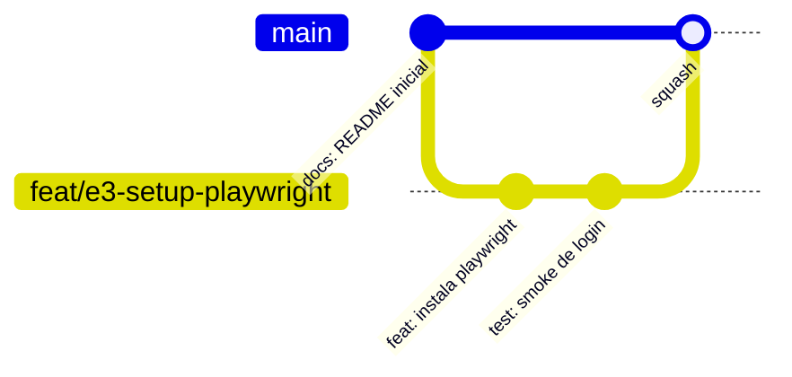
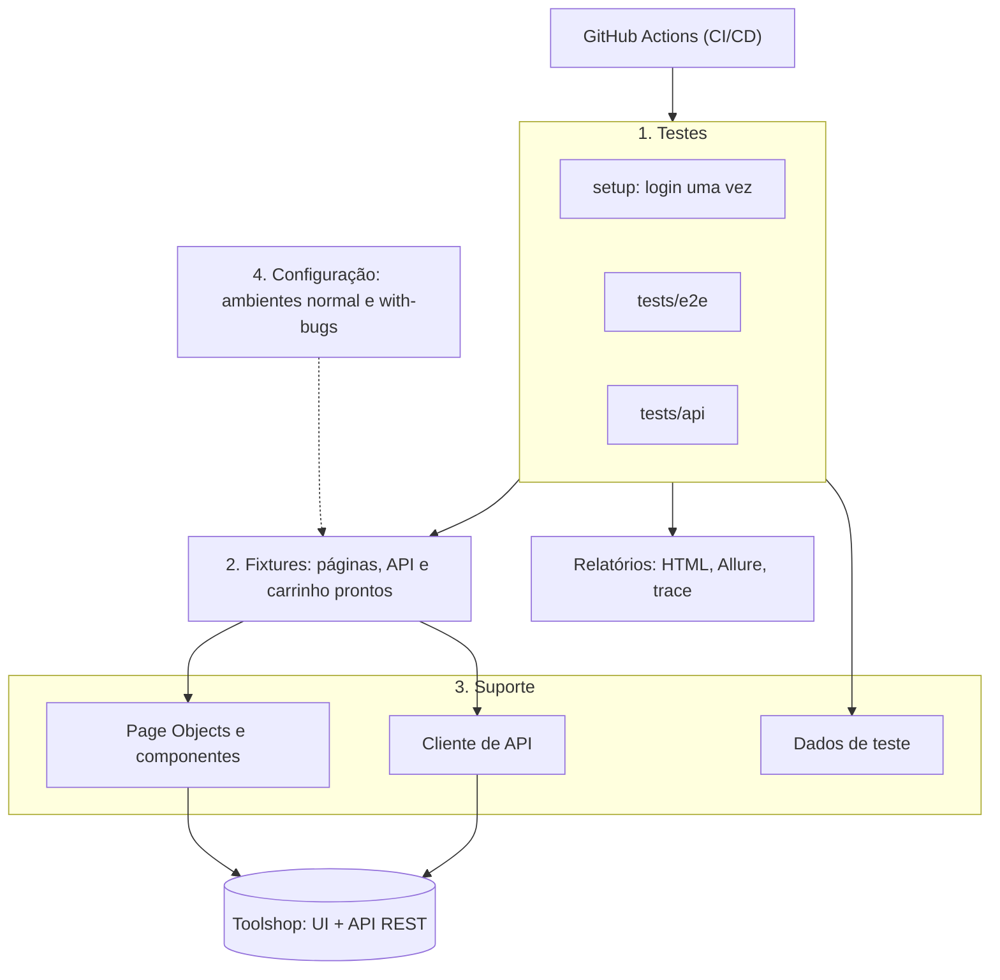

# Toolshop Automation AI

Automação de testes E2E da loja [Toolshop](https://practicesoftwaretesting.com) com **Playwright + TypeScript**, usando **IA generativa** para apoiar o design dos cenários e o código dos testes, sempre com revisão humana.

O foco é o **domínio de pagamento**: carrinho, checkout e as 5 formas de pagamento da loja, testados com técnicas do ISTQB CTFL (partição de equivalência, valor-limite, tabela de decisão e transição de estados).

> **Sobre a aplicação testada:** o Toolshop é um projeto da [Testsmith](https://github.com/testsmith-io/practice-software-testing) criado para praticar testes de software. O código da aplicação **não faz parte** deste repositório. Aqui estão apenas os meus testes, documentação e análises.

## Objetivos

- Construir uma suíte de testes automatizados com arquitetura em camadas, CI/CD e relatórios.
- Medir na prática **onde a IA acerta e onde erra** ao gerar casos e código de teste.
- Rodar a mesma suíte na versão normal e na [versão com bugs propositais](https://with-bugs.practicesoftwaretesting.com) do Toolshop e comparar os resultados.

## Roteiro

| Etapa | Descrição                                                 | Status |
| ----- | --------------------------------------------------------- | ------ |
| E0    | [Exploração da aplicação](docs/e0-exploracao.md)          | ✅     |
| E1    | [Repositório e fluxo de trabalho](docs/e1-repositorio.md) | ✅     |
| E2    | [Arquitetura](docs/arquitetura.md)                        | ✅     |
| E3    | Instalação do Playwright e primeiro teste                 | ⏳     |
| E4    | CI/CD com GitHub Actions + relatório Allure               | ⏳     |
| E5    | Cenários de teste com IA                                  | ⏳     |
| E6    | Plano de testes                                           | ⏳     |
| E7    | Automação: login, catálogo, carrinho e checkout           | ⏳     |
| E8    | Execução: versão normal x versão com bugs                 | ⏳     |
| E9    | Métricas e resultados                                     | ⏳     |

## Fluxo de trabalho

O projeto segue o **GitHub Flow**: a `main` é protegida e toda mudança entra por Pull Request, com squash merge.



**Branches:** `tipo/etapa-descricao`. Quando a mudança não for de uma etapa específica, use a branch geral do tipo, que já existe (ex.: `docs/general`), em vez de criar uma nova.

| Tipo        | Uso                              | Exemplo                      |
| ----------- | -------------------------------- | ---------------------------- |
| `feat/`     | Estrutura e configuração         | `feat/e3-setup-playwright`   |
| `test/`     | Novos testes                     | `test/e7b-checkout-cartao`   |
| `fix/`      | Correção de teste                | `fix/login-seletor-instavel` |
| `refactor/` | Melhoria sem mudar comportamento | `refactor/e7-page-objects`   |
| `ci/`       | Pipeline e relatórios            | `ci/e4-github-actions`       |
| `docs/`     | Documentação                     | `docs/e6-plano-de-testes`    |

**Commits:** [Conventional Commits](https://www.conventionalcommits.org/pt-br/), com o tipo e a descrição em inglês. Exemplos: `feat: create page object for checkout`, `test: add scenarios CVV`, `ci: run smoke tests all PR`.

**Pull Requests:** todo PR usa o [modelo do projeto](.github/pull_request_template.md), que inclui a seção **"Uso de IA"**: o que foi gerado por IA e o que foi revisado ou corrigido.

**Defeitos:** registrados como [issues](.github/ISSUE_TEMPLATE/bug_report.yml) com o modelo de bug report, separando **severidade** (impacto) de **prioridade** (urgência).

## Arquitetura (E2)

Arquitetura em camadas com **Page Objects, componentes e fixtures** do Playwright. Cada camada tem uma responsabilidade só.



### Estrutura de pastas

```
├── .github/          → CI, modelos de PR e de bug report
├── docs/             → exploração, casos de teste, arquitetura, métricas de IA
├── src/
│   ├── config/       → ambientes (UI e API) e variáveis do .env
│   ├── pages/        → Page Objects (login, catálogo, produto, checkout)
│   ├── components/   → partes reaproveitadas (cabeçalho, formulário de pagamento)
│   ├── api/          → cliente da API REST
│   ├── data/         → dados de teste: partições e valores-limite
│   └── fixtures/     → fixtures do Playwright
└── tests/
    ├── setup/        → autenticação com sessão salva
    ├── e2e/          → testes de ponta a ponta
    └── api/          → testes de API
```

### Regras da arquitetura

1. **O teste não usa seletor:** quem conhece a tela é o Page Object.
2. **O Page Object não faz asserção:** ele executa ações e expõe elementos. Quem valida é o teste.
3. **Seletores por ordem de preferência:** `getByTestId` (`data-test`) > `getByRole` > texto > CSS.
4. **Locator com escopo:** quando o `data-test` se repete, a busca parte do formulário, passo ou card.
5. **Sem dependência de massa compartilhada:** nada de IDs gerados, marcas ou conta demo; o carrinho é criado em cada teste.
6. **Todo teste tem tag** da regra e do caso que cobre (`@RNxx`, `@CT-xx`); os críticos também levam `@smoke`.
7. **Código gerado por IA só entra via PR**, com a seção "Uso de IA" preenchida.

Detalhes, decisões e riscos em [docs/arquitetura.md](docs/arquitetura.md).

## Autor

Bruno Aurelio, Analista de Automação - QA - Testes · [LinkedIn](https://www.linkedin.com/in/brunoaurelio)
