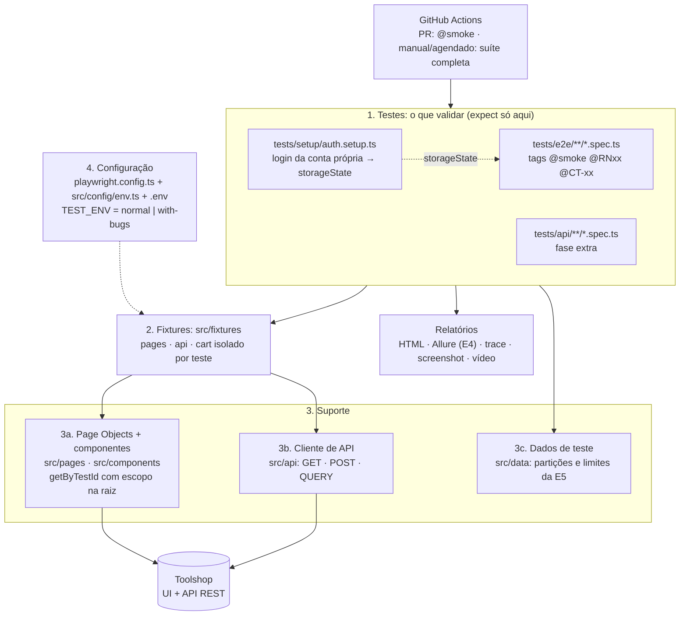

# E2 – Arquitetura da automação

Desenho da suíte de testes do Toolshop com **Playwright Test + TypeScript**. A arquitetura é em camadas e cada camada tem uma responsabilidade só: o teste diz **o que** validar, o Page Object sabe **como** usar a tela, o cliente de API **prepara** os cenários e a configuração define **onde** a suíte roda.

Base do desenho: [E0 – Exploração](e0-exploracao.md) (regras RN01–RN29 e seletores) e [E5 – Casos de teste](tesCases.md) (CT-xx).

## 1. Diagrama de camadas



| Camada         | Responsabilidade                                                                | Não faz                       |
| -------------- | ------------------------------------------------------------------------------- | ----------------------------- |
| Testes         | Monta o cenário, chama as ações e faz as asserções (`expect`)                   | Não usa seletor               |
| Fixtures       | Entrega Page Objects, cliente de API e carrinho prontos, sem `beforeEach` comum | Não contém regra de negócio   |
| Page Objects   | Encapsula seletores e ações de uma tela ou componente; expõe locators           | Não faz asserção              |
| Cliente de API | Cria e consulta dados rapidamente (login, carrinho, produtos)                   | Não substitui o teste de tela |
| Dados de teste | Tabelas de partições e valores-limite; uma linha vira um teste                  | Não guarda credenciais        |
| Configuração   | Escolhe o ambiente (UI e API), navegador, paralelismo e evidências              | Não tem lógica de teste       |

## 2. Estrutura de pastas

```
toolshop-automation-ai/
├── .github/
│   ├── workflows/             → CI (E4)
│   ├── ISSUE_TEMPLATE/        → bug report (E1)
│   └── pull_request_template.md
├── docs/
│   ├── e0-exploracao.md       → E0: regras e seletores
│   ├── tesCases.md            → E5: casos CT-xx (fonte das tags)
│   ├── arquitetura.md         → E2: este documento
│   └── metricas-ia.md         → E9
├── src/
│   ├── config/env.ts          → TEST_ENV → { uiURL, apiURL } e credenciais do .env
│   ├── pages/                 → LoginPage, ProductListPage, ProductPage, CheckoutPage
│   ├── components/            → HeaderComponent, PaymentForm
│   ├── api/                   → ApiClient, auth, carts, products
│   ├── data/                  → users, addresses, payment-methods
│   └── fixtures/index.ts      → test e expect estendidos
├── tests/
│   ├── setup/auth.setup.ts    → login uma vez, salva a sessão
│   ├── e2e/                   → login/, catalogo/, produto/, carrinho/, checkout/, pagamento/
│   └── api/                   → fase extra de API
├── playwright/.auth/          → sessão salva (fora do Git)
├── playwright.config.ts
└── .env.example
```

## 3. Ambientes

A mesma suíte roda nas duas versões do Toolshop. O ambiente é escolhido por `TEST_ENV`, e `src/config/env.ts` devolve as URLs da UI e da API.

| `TEST_ENV`        | UI                                              | API                                                 |
| ----------------- | ----------------------------------------------- | --------------------------------------------------- |
| `normal` (padrão) | `https://practicesoftwaretesting.com`           | `https://api.practicesoftwaretesting.com`           |
| `with-bugs`       | `https://with-bugs.practicesoftwaretesting.com` | `https://api-with-bugs.practicesoftwaretesting.com` |

Na E8, o teste que passa no `normal` e falha no `with-bugs` aponta um bug confirmado.

Configuração base do `playwright.config.ts`:

- `testIdAttribute: 'data-test'`, porque o Toolshop usa esse atributo de forma ampla (E0, seção 3) — E3;
- só **chromium**, `workers: 2` e `retries` apenas no CI: o site é público e compartilhado — E3;
- evidências: `trace: 'on-first-retry'`, `screenshot: 'only-on-failure'`, `video: 'retain-on-failure'` — E3;
- projetos: `setup` (gera a sessão) → `chromium` (`dependencies: ['setup']` e `storageState: 'playwright/.auth/user.json'`) — **E7a** (na E3 existe só o projeto `chromium`).

## 4. Decisões e motivos

| Decisão                                        | Motivo                                                                                                                                             |
| ---------------------------------------------- | -------------------------------------------------------------------------------------------------------------------------------------------------- |
| Page Objects + componentes                     | O pagamento tem 5 formas com campos diferentes; o `PaymentForm` concentra isso e evita repetição                                                   |
| `CheckoutPage` com um método por passo         | `cart()`, `signIn()`, `billing()`, `payment()` deixam a transição de estado do wizard (RN14) visível no teste                                      |
| Fixtures do Playwright                         | O teste recebe páginas, API e carrinho prontos, sem `beforeEach` repetido                                                                          |
| Login uma vez com sessão salva (conta própria) | Testes mais rápidos e menos requisições ao site público. A conta demo está bloqueada (E0)                                                          |
| Carrinho isolado por teste                     | Os testes rodam em paralelo; um carrinho novo (pela API ou como convidado) evita que um teste altere o carrinho de outro                           |
| Cliente de API para preparar cenários          | Criar carrinho pela API é mais rápido e estável. Busca e filtros usam o método HTTP `QUERY`, enviado com `request.fetch(url, { method: 'QUERY' })` |
| Dados separados em `src/data`                  | Partições e valores-limite da E5 viram tabelas; o teste percorre as linhas e gera um caso por linha                                                |
| Rastreabilidade por tags                       | `test('...', { tag: ['@RN22', '@CT-47'] })` liga o teste à regra e ao caso da E5, e `--grep` filtra a execução                                     |
| Playwright puro, sem Gherkin                   | Os cenários já estão em `docs/tesCases.md` (tabelas Ação / Resultado esperado); uma camada Cucumber só acrescentaria manutenção                    |
| Testes anônimos sem sessão                     | Login, registro e busca usam `test.use({ storageState: { cookies: [], origins: [] } })`                                                            |

## 5. Regras da arquitetura

1. **O teste não usa seletor:** quem conhece a tela é o Page Object.
2. **O Page Object não faz asserção:** ele executa ações e expõe locators. Quem valida é o teste.
3. **Seletores por ordem de preferência:** `getByTestId` (`data-test`) > `getByRole` > texto > CSS. `getByRole` e texto ficam para o que não tem `data-test`: aba "Continue as Guest", toasts, paginação numérica, sliders de preço e mensagens de validação do pagamento.
4. **Locator com escopo:** quando o `data-test` se repete (`email`, `password`, `country`, `product-name`, `product-price`), o Page Object busca a partir do formulário, passo ou card.
5. **Sem dependência de massa compartilhada:** nada de ULIDs, nomes de marca ou conta demo; o carrinho é criado em cada teste.
6. **Todo teste tem tag:** a regra e o caso que cobre (`@RNxx`, `@CT-xx`); os críticos também levam `@smoke`.
7. **Código gerado por IA só entra via PR**, com a seção "Uso de IA" preenchida.

As regras 1 e 2 serão garantidas pelo ESLint (E3): `no-restricted-syntax` proíbe `locator`/`getBy*` em `tests/e2e/**`, e `no-restricted-imports` proíbe `expect` em `src/pages/**` e `src/components/**`.

## 6. Riscos e como a arquitetura trata cada um

| Risco                                                                                                  | Tratamento                                                                                                  |
| ------------------------------------------------------------------------------------------------------ | ----------------------------------------------------------------------------------------------------------- |
| A conta da sessão é bloqueada para sempre após 3 senhas erradas (RN27), e isso derruba a suíte inteira | Testes de senha inválida e de bloqueio usam e-mail inexistente ou conta descartável, nunca a conta do setup |
| Testes em paralelo disputam o carrinho da mesma conta                                                  | Carrinho novo por teste (fixture `cart`) ou checkout como convidado                                         |
| Site público, sem SLA, com dados alterados por terceiros                                               | Poucos workers, retries só no CI, nenhuma asserção sobre contagens absolutas do catálogo ou nomes de marca  |
| Bug intermitente do "Check payment" habilitado com campos vazios (CT-52)                               | Registrar como issue e marcar o teste com `test.fail()` e o link, em vez de deixá-lo instável               |
| Credenciais vazando no repositório                                                                     | `.env` fora do Git, `.env.example` sem dados reais, GitHub Secrets no CI                                    |

## 7. Onde a IA entra

- **E2:** revisar este desenho e apontar riscos (seção 6).
- **E3/E7:** rascunhar Page Objects (a partir do HTML ou do codegen) e testes (a partir dos casos da E5), revisados contra as regras da seção 5.
- **E8:** analisar os traces das falhas e sugerir a causa: bug real, teste instável ou mudança na tela.

O que a IA gerou e o que foi corrigido fica registrado no PR e consolidado em [metricas-ia.md](metricas-ia.md).
